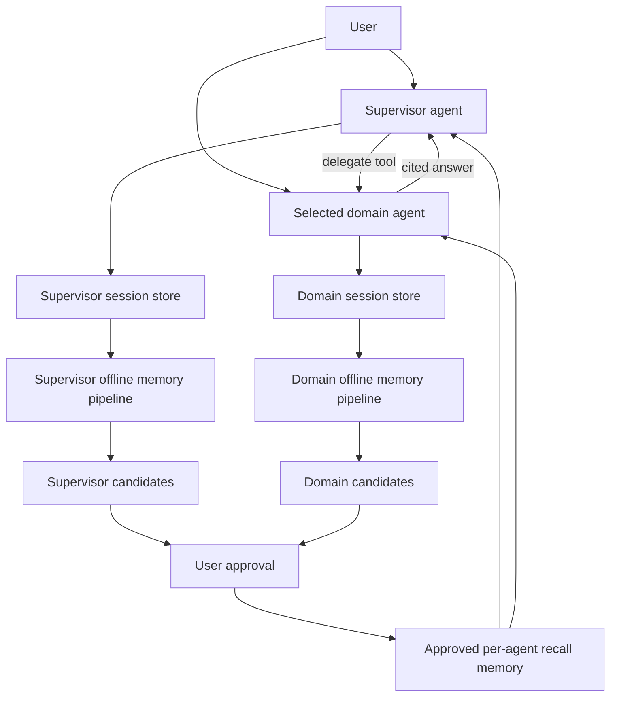

# Pipeline Compass

**Requirements, decisions, and design memory for every pipeline.**

A Databricks Apps prototype with four independent specialists—Valuation, Research & Evidence, Portfolio, Platform & Data—and a supervisor. Each agent has its own prompt, approved seeded memory, native session store, native memory store, and native scheduled consolidation pipeline. `agent-resources.json` records the actual provisioned resources.



## Runtime

`agents.py` runs actual model tool-call loops. The supervisor delegates to specialists using `delegate(domain, task)`, then synthesizes their answers. Specialists search only their domain-filtered document corpus. Calls, results and errors are journaled; private reasoning is not requested or stored. Specialist child conversations preserve the original user question, label the supervisor-generated task, and link to the parent supervisor conversation. Each is independently persisted and consolidated.

Direct chats and supervisor chats save user messages **before** model execution. Every completed assistant answer, tool call/result and error is recorded in SQLite locally or the existing isolated `knowledge_agent` Lakebase schema when deployed. Native session delivery uses immutable event IDs, checks already-delivered IDs on retry, and retains pending journal events when delivery fails. A background worker retries pending deliveries every 30 seconds. Manual consolidation flushes pending delivery before starting a run. The UI supports conversation history and resuming owned sessions, including viewing recorded tool/delegation events.

## Native offline consolidation and approval

The five native Databricks memory pipelines run on demand or approximately every 24 hours, as described in [Databricks memory pipelines](https://docs.databricks.com/aws/en/agents/agent-memory/memory-pipelines). These are native serverless jobs, not an in-request memory extraction imitation. Runs execute as the provisioning user and incur serverless/model charges.

For each agent, session actor `candidate` writes pipeline output into the same actor partition of that agent's memory store. Agents recall only actor `approved`. A review publishes a candidate snapshot to `/learned/<digest>.md` in the approved partition; rejection does not publish. All app users may approve/reject. The digest binds a review to the candidate's current content. Pipeline maintenance cannot modify the approved partition because no sessions use that actor. Actor IDs are **not ACLs**: store permissions and trusted application code enforce the boundary. The app principal has WRITE on the five stores and cannot use UI-supplied actor IDs.

Each agent starts with three approved curated memories. `/seed/` entries identify project facts, historical requests, configuration, or synthetic examples. Human-approved corrections under `/learned/` take precedence over conflicting seeds. Historical excerpts are imported as provenance-labelled session evidence; user requests are never asserted to be shipped features. The source bundle includes 29 project documents, five conversation excerpt files and one synthetic Atlas document.

## Local use and deployment

Use Python 3.12 and install with `uv sync`. Set `DATABRICKS_CONFIG_PROFILE=fevm`, `DATABRICKS_AUTH_STORAGE=plaintext`, `SERVING_ENDPOINT=system.ai.claude-sonnet-4-6` and `AI_GATEWAY_URL` to the workspace Unity Gateway `/mlflow/v1` URL. Run `.venv/bin/uvicorn app:app --host 127.0.0.1 --port 8788`. Without a configured model, the local prototype explicitly shows approved-memory excerpts and does not claim model synthesis or delegation.

Provision with `.venv/bin/python scripts/provision_agents.py`, then import historical sessions with `scripts/seed_agent_sessions.py`. Both are restartable. The provisioner also grants the app CAN_MANAGE_RUN on only the five underlying native pipeline jobs; scheduled jobs continue to run as their creator. Native stores are workspace scoped. The provisioner grants the existing app service principal access to only these stores. `app.yaml` preserves the deployed Lakebase/warehouse settings. Sync to the `workspace_path` in `deployment.json` and deploy the existing `research-memory-poc` app using profile `fevm`.

## Validation and limits

Run `.venv/bin/python -m pytest -q`. `scripts/check_agents_v2.py` checks real supervisor delegation across three domains and verifies separate child sessions and native delivery; set `CHECK_URL` to the deployed app URL to validate there. Artifacts are written locally under `artifacts/` and excluded from deployment.

The original first-cut `sessions/messages/memories/audit` tables remain preserved. Its manually submitted memory archive is not recalled by the new agents. The new runtime uses `agent_sessions`, `agent_events`, `agent_reviews`, and native agent stores. Domain document scoping uses an explicit domain keyword registry; production use should replace this with governed source assignments and evaluate domain routing quality. Approved memory recall currently loads the agent's approved entries, appropriate for a small POC.

Live SQL remains available in the Tables tab, under the forwarded end-user token with fixed read-only query templates and a fixed catalog; scans require confirmation. Agent chat does not execute SQL. Native session history provides the full action transcript. Existing MLflow experiment metadata remains configured, but full MLflow span artifact upload is not verified because the storage host is unreachable from this environment; this implementation makes no claim of successful full trace export.

Verified: 14 local tests, local and deployed three-domain supervisor delegation, native session delivery, browser controls, and native domain/supervisor candidate generation. Synthetic supervisor approval and fresh-session recall were verified locally; see artifacts for run evidence.

## Create agents in the UI

Open **Manage agents → Add agent**. Enter a unique ID, name, domain description, and retrieval keywords. Add one or more baseline memories, each with a topic, content, and source. The creator must explicitly approve the baseline for shared recall before submitting. Any signed-in user may create an agent under this pilot's approval policy.

Setup provisions a native memory store, session store and scheduled memory pipeline for that agent. The creator identity for these resources is the application service principal when deployed, or the `fevm` user locally. Domain definitions, seed approval provenance and resource IDs live in the durable `agent_definitions` table (SQLite locally, Lakebase deployed), so they survive reloads, process restarts and code redeployments. A ready agent appears in the selectors and supervisor tool directory without code changes or another deployment.

The UI shows setup progress and offers **Retry setup** after failures. Provisioning checkpoints each native resource; retries reuse completed work, and interrupted setup resumes in the background. Only ready agents can receive conversations. New learned memories still use the existing candidate → user approval flow. Local and deployed registries use their respective databases; creating an agent locally does not automatically copy it to the deployed registry.

Validation: `scripts/browser_create_agent.py` creates a clearly synthetic Compliance Demo via the browser, seeds two baseline memories, reloads, verifies direct recall, and verifies supervisor delegation. Verified locally and in the deployed app: UI creation, two approved baseline memories, reload persistence, direct model recall, and automatic supervisor delegation to the new agent. Registry tests cover persistence, explicit baseline approval, reserved/duplicate IDs, and setup retries. The complete suite has 17 passing tests.

## Daily conversation updates

Open **Daily updates** to view an agent's Markdown archive or generate an update for a selected date. Job `552665911450232` runs daily at **00:15 Asia/Dubai**, summarizing the previous Dubai calendar day. It discovers all ready agents automatically, including the supervisor and agents created in the UI.

Files are saved as `/Volumes/satish_doc_intelligence_catalog/agent_memory/daily_updates/<agent-id>/YYYY-MM-DD.md`. Each file summarizes the saved application conversation journal: topics, decisions/corrections, work/outcomes, and open questions/actions, with event citations and conversation references. Agents without activity receive an explicit empty-day update. These shared activity archives are unreviewed and are not imported into approved recall memory. Access follows the volume's permissions; summaries can contain shared conversation information. Common credentials and email addresses are redacted, but this is not comprehensive data-loss prevention.

The task uses the job owner's identity to read Lakebase and write the volume; the app has read-only volume access and permission to start this fixed job. Rerunning an unchanged day skips existing output; late conversations regenerate the same dated file. Failed agents are retried without rewriting successful unchanged files. Backfill through the UI date picker or the job's `date` parameter (`YYYY-MM-DD`); an empty `agent` parameter processes all ready agents. Provision/reset the schedule with `scripts/provision_daily_updates.py` after syncing the source. For local exports use `.venv/bin/python daily_updates.py --date YYYY-MM-DD --local-dir artifacts/daily-updates`.

Verified daily updates: 22 local tests pass; serverless run `295723551219159` wrote files for all six deployed agents (including the supervisor, custom Compliance Demo, and an empty-activity Platform update). The deployed browser check displayed the valuation Markdown through the app's read-only volume identity.

## Connect from Cursor through MCP

Each ready agent has a Streamable HTTP MCP endpoint at:

`https://research-memory-poc-7474653807068368.aws.databricksapps.com/mcp/<agent-id>`

| Agent | Endpoint suffix | Chat tool |
| --- | --- | --- |
| Valuation | `/mcp/valuation` | `ask_valuation` |
| Research & Evidence | `/mcp/research` | `ask_research` |
| Portfolio | `/mcp/portfolio` | `ask_portfolio` |
| Platform & Data | `/mcp/platform` | `ask_platform` |
| Supervisor | `/mcp/supervisor` | `ask_supervisor` |
| Compliance Demo | `/mcp/compliance-demo` | `ask_compliance_demo` |

The combined endpoint `/mcp/` discovers all ready agents. Agents created through the UI immediately gain their own endpoint and appear in combined discovery; no redeployment is needed. Tool names replace hyphens in agent IDs with underscores. Each individual endpoint also exposes `list_conversations` and `get_conversation`, restricted to the authenticated user's conversations with that agent.

For Cursor on this machine, the six servers are installed in the parent workspace's **`../.cursor/mcp.json`**. Open `/Users/satish.terala/Work/adia` in Cursor and reload MCP servers. To use another workspace or global configuration, merge the `mcpServers` entries from **`cursor-mcp.json`** into that project's `.cursor/mcp.json` or `~/.cursor/mcp.json`, keeping any existing server entries. This configuration launches `scripts/cursor_mcp.py` using the project's virtual environment, connects to the deployed endpoint, and refreshes credentials using your existing `fevm` Databricks profile. It contains no tokens. If login has expired, run `DATABRICKS_AUTH_STORAGE=plaintext databricks auth login --profile fevm --host https://fevm-satish-doc-intelligence.cloud.databricks.com`. The profile's identity must have permission to use the Databricks app.

Regenerate the configuration after adding agents, or when installing on another machine:

```bash
uv sync
DATABRICKS_AUTH_STORAGE=plaintext .venv/bin/python scripts/configure_cursor.py
```

The generated file uses absolute paths for the current machine. The connector supports `--profile`, `--url`, and `--agent`; omit `--agent` to expose the combined directory in one Cursor server. Remote MCP clients can connect directly using a Databricks OAuth bearer token in the `Authorization` header; direct URL mode does not implement its own OAuth discovery/login flow, so the provided connector is the recommended Cursor setup. Databricks Apps validates remote credentials and forwards user identity; local demo identity headers are ignored in deployment.

Example Cursor prompt: “Use the Valuation agent to explain which checks are required before publishing a fair value.” Chat arguments are `question` and optional `session_id`. Save the returned `session_id` and pass it to continue a conversation. Requests use the existing agent runtime, approved recall memory, domain retrieval and supervisor delegation. Every user/assistant/tool/error event is saved to the same durable journal as UI chats and enters the existing offline memory pipeline and daily activity summaries. Learned shared memory continues to require user approval in the app. The MCP surface does not provide approval or live SQL tools. Tool results include the answer, sources, session ID and any delivery warning.

Protocol checks: `.venv/bin/python -m pytest -q` covers user/agent isolation, durable chat continuation, dynamic agent discovery, input validation, deployed identity and cross-origin enforcement. `DATABRICKS_AUTH_STORAGE=plaintext .venv/bin/python scripts/check_mcp.py` verifies the deployed endpoints and the stdio connector used by Cursor.

Verified MCP deployment: 25 tests pass; all six deployed endpoints support MCP initialization/discovery; a real two-turn valuation chat retained its session and four user/assistant message events; cross-agent history access was rejected. The exact Cursor stdio connector authenticated with `fevm`, discovered tools, and retrieved the conversation list successfully. Dependency artifacts use public PyPI URLs with the lockfile hashes retained because the app runtime cannot reach the local internal mirror.

## Agent workspace

The conversation page shows all ready agents in a persistent directory, with the supervisor first. Click an agent to switch its title, purpose, accent, suggested questions, composer, memory controls and saved conversations. Custom agents appear when the directory is refreshed, without a frontend deployment. Drafts and the selected conversation are retained per agent while the page is open. Background replies stay with their originating agent; returning to that agent restores its saved transcript. The directory becomes a grid on smaller screens. Use **Add an agent** from the directory to open the existing creation and baseline-memory form.

`DATABRICKS_AUTH_STORAGE=plaintext .venv/bin/python scripts/browser_agent_workspace.py` checks the UI using synthetic browser fixtures, including delayed replies, independent sessions/drafts, memory context, dynamic agents and responsive widths. It does not send model requests or add baseline knowledge. Set `CHECK_URL` to check the deployed assets with the same fixtures.

Verified agent workspace deployment: all six real deployed agents appear and switch context correctly; independent drafts and the mobile layout pass. `scripts/browser_agent_workspace_live.py` performs this read-only live check. Synthetic browser fixtures also pass against deployed assets for delayed responses, saved transcripts, memory context and dynamically added agents. The backend suite remains at 25 passing tests.

The visual theme follows the Document Intelligence reference app: Databricks lava red (`#ff3621`), navy text (`#1b3139`), a light gray canvas (`#f6f7f9`), white cards and locally hosted DM Sans. The font license is in `static/fonts/OFL.txt`. `scripts/browser_theme.py` verifies colors, font loading, navigation, dialogs and responsive layout; set `CHECK_URL` for the deployed app.

## Knowledge register, capture and approval

Each agent owns a structured **knowledge register** (`knowledge.py`; tables `knowledge_items`, `knowledge_item_history`, `knowledge_links`, `agent_members`) holding requirements, business rules, decisions, open questions, TODOs, changes, sources, data-model entries, glossary terms and notes. Every item has a ref (`D-004`, `Q-012`…), a status, who recorded it, who decided it, who approved it, the channel (web, Cursor, starting knowledge, import, conversations) and a link to the exact conversation turn it came from. Every change is a history row.

- **Capture in chat.** Agents have `find_knowledge` and `suggest_record` tools. When someone states or confirms something durable, the agent offers a card below its answer (*Record & send for approval / Edit / Dismiss*). Any message also has **＋ Record**, and the composer has a **＋ Record** button. Agents check the register first and won't suggest duplicates; contradictions are offered as replacements (`supersedes`).
- **Approval.** Decisions, requirements, rules, sources, model and glossary items are `proposed` until an owner or approver accepts them in **Review**. Nobody approves their own item unless they are the only approver. With no owners configured, anyone except the recorder can approve. Questions, TODOs, changes and notes are recorded straight away. Accepted items are immutable; replace them with a new version.
- **Starting knowledge and import.** **Agents → Add agent** takes typed items; it and **Knowledge → Import files** accept a pipeline design folder (`spec`, `sources`, `model`, `rules`, `decisions`, `todos`, `glossary`, `changes`.md), parsed deterministically, including who decided, owners and due dates. Any other document (meeting notes, a spec) is classified by the model into typed items (`knowledge.classify_document`), shown for review with editable types before anything is imported. The creator becomes an owner. Demo seed folders, a sample document and the architecture deck are in `demo/` (not deployed).
- **Knowledge tab.** Filter by type, status and text; open an item for details, history, links and its source conversation; **Export markdown** downloads the scaffold-style files (decisions append-only, `model.md` with generated DDL and Mermaid ERD).
- **Recall.** Agents receive a short register brief (counts, latest decisions, open questions) and query details with `find_knowledge`. Active items are projected to the agent's managed memory store under `/register/<type>/<ref>.md`, retried in the background; new memory pipelines write typed candidates under `/candidates/`, which are ingested as proposed items. Pipelines created before this change keep their original policy.
- **Daily updates** gain a factual *Recorded knowledge* section built from register history.

**Shared conversations.** Conversations are visible to all signed-in users and anyone can continue one; each message records its author. A conversation can be made private by its starter. Identity uses `x-forwarded-email`.

**Cursor (MCP)** adds `record_item`, `find_knowledge`, `get_item`, `confirm_suggestion`, `dismiss_suggestion`, `answer_question`, `update_todo` and `export_markdown`; `ask_*` results include `suggestions`. Items recorded from Cursor are tagged `channel=cursor`. On the combined `/mcp/` endpoint pass `agent`.

Checks: `.venv/bin/python -m pytest -q` (36 tests). `scripts/browser_knowledge.py` drives the agent switcher, chat capture → send for review → approval by a second user, the shared conversation drawer, and the folder import in Add agent, saving `artifacts/focus-*.png`. Run it only against a local server without `agent-resources.json`, `LAKEBASE_HOST` or a warehouse; it uses the built-in Platform & Data agent and does not submit Add agent (set `CREATE_AGENT=1` to submit), because creating an agent provisions real native resources in the configured workspace.

## Layout

The UI follows the *Focus layout* design: a top bar with the logo, an agent switcher (search, current, recent, all agents, and Supervisor · auto-route), a conversations button and a menu for the other pages (Knowledge, Review, Agents, Daily updates, Documents, Explore tables, Activity); a **project record** bar with live counts for the selected agent (open questions, items awaiting review and open TODOs are highlighted; new decisions, requirements and rules show "· new"); a single centered conversation with the composer pinned at the bottom; and a conversations drawer (Everyone / Mine, search, grouped by day). Capture cards and source chips appear under each answer; tool steps are behind "Show steps". The Private checkbox applies to a new conversation, or lets the starter change an existing one.
