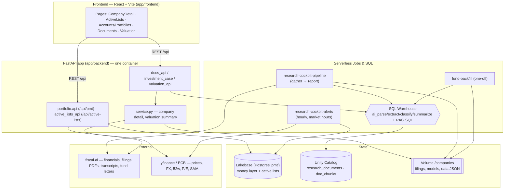
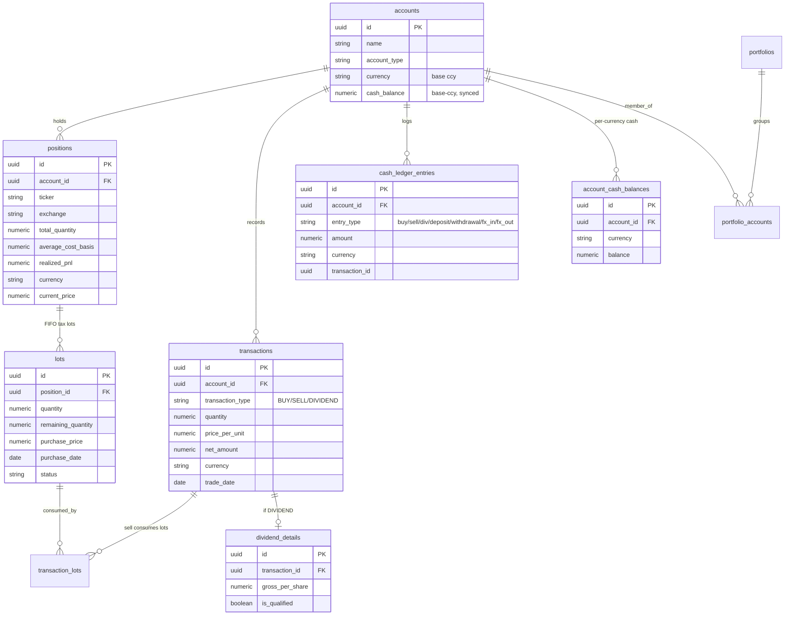
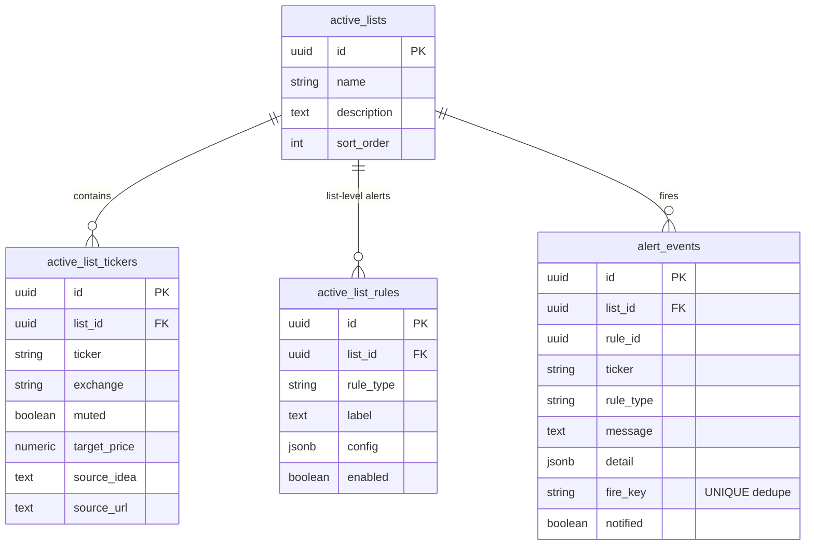
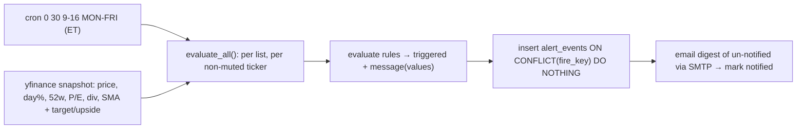

# Project document: system-reference

Source: research_val_personal/docs/system-reference.md
Kind: design document; may describe planned rather than shipped features.

# Research Cockpit — System Reference

A ready reference for the architecture, data model, flows, metrics math, and valuation
engine. Diagrams are Mermaid (render on GitHub / most markdown viewers).

_Last updated: 2026-09-10._

---

## 1. Overview

Research Cockpit is a React (Vite) + FastAPI Databricks App with three cooperating layers:

- **Research & documents** — pulls primary sources (filings, transcripts, fund letters) into a
  Unity Catalog document store, runs `ai_*` SQL functions on a SQL Warehouse, and serves
  corpus chat (RAG) over embedded chunks.
- **Valuation** — a deterministic DCF/scenario/comps engine that produces a fair value per share,
  with guardrails against absurd outputs.
- **Money layer (PMT)** — accounts, positions, transactions, cash and performance, backed by
  Lakebase (Postgres), plus Active Lists watchlists with scheduled email alerts.

Deployment (fevm workspace): app `research-cockpit`; doc store
`satish_doc_intelligence_catalog.research_cockpit`; SQL Warehouse `f7eaba73b2f9c0dc`; data volume
`/Volumes/satish_doc_intelligence_catalog/research_cockpit/research`; Lakebase db `pmt`.
Scheduled jobs: research pipeline `557334341404887`, alerts `477252853783997`, fund backfill
`394494301949554`.

---

## 2. Architecture



Everything AI runs as SQL (`ai_query`, `ai_parse_document`, `ai_extract`, …) on the Warehouse — the
container never parses documents or calls an external model API. fiscal.ai is the only external
data credential; FX/quotes come from yfinance + ECB (frankfurter).

---

## 3. Data model

### 3.1 Money layer (Lakebase `pmt`, schema `public`)



Key points:
- **`account_cash_balances`** (added 2026-09) is the source of truth for cash, one row per
  `(account, currency)`. `accounts.cash_balance` is kept in sync **only** for the base currency
  (legacy readers). See §4.4 / §5.
- **Lots** are FIFO; a SELL consumes open lots via `transaction_lots` and books realized P&L.
  `transaction_lots.lot_id` is `ON DELETE RESTRICT` (a consumed lot can't be deleted).
- Prices: `daily_prices` (history), `eod_prices`, `market_bar_symbols`; NAV series in
  `nav_series` / `portfolio_nav` (built by metrics).

### 3.2 Active Lists (Lakebase `public`)



`rule_type` ∈ `pe_below · at_52w_low · price_below_sma · target_reached · pct_fall_after_earnings ·
custom`. `fire_key = rule_id:ticker:YYYY-MM-DD` dedupes one firing per rule/ticker/day.

### 3.3 Document store (Unity Catalog)

- **`research_documents`** (PK `file_path`): `folder_path, ticker, doc_class, source, source_url,
  period, filed_date, content_sha256, parsed_text, parsed_doc, entities`. Sections are separate
  rows. `doc_class` ∈ `filing_raw · mdna · risk_factors · business · transcript · ir_deck ·
  press_release · article · fund_letter`.
- **`doc_chunks`**: `chunk_id` (PK), `ticker, doc_class, section, source_tier, form_type, period,
  filed_date, country, sector, file_path, char_len, embedding ARRAY<FLOAT>[1024]`. CDF enabled.
  Source tiers: `fact` (filings) > `management` (transcript/deck/PR) > `third_party`
  (article/fund_letter).

### 3.4 Per-company files (volume `/companies/<TICKER>/`)

`data/` (normalized statements, ratios.json, fund_letters.json, stock_prices…) · `filings/`
(PDFs, `transcripts/*.txt`) · `models/<T>-assumptions-full.json` + `-model.xlsx` · `reading/`
(ingested articles) · `outputs/` (report, deck) · `status.json` (funnel state).

---

## 4. Flows

### 4.1 Research pipeline (`research-cockpit-pipeline`)

Stage DAG (each stage = `python -m` module via `run_stage.py`; non-fatal stages `warn` and
continue). `depth` gates: `screen` < `data` < `research` < `full`.

```mermaid
flowchart LR
  gather --> normalize --> screen
  screen --> research --> index_docs --> ingest_text --> ingest_funds --> sections --> chunk_index
  chunk_index --> entities --> summarize --> insights --> dr_prompt
  dr_prompt --> assumptions --> report
```



- `index_docs` parses filing PDFs via `ai_parse_document`; `ingest_text` loads transcripts/articles;
  **`ingest_funds`** flattens fiscal.ai fund-letter theses into `research_documents`
  (`doc_class=fund_letter`); `sections` splits 10-K/10-Q Items; `chunk_index` embeds all non-`filing_raw`
  docs into `doc_chunks`.
- `assumptions` auto-fits a draft model; `report` builds the Excel model + PDF + deck.

### 4.2 RAG / Ask


Fund letters are in the corpus, so Ask reasons over institutional views alongside filings/transcripts.

### 4.3 Alerts evaluator (`research-cockpit-alerts`, hourly, market hours ET)



`ALERT_EMAIL_FROM/TO`. Delivery uses `EmailMessage` (UTF-8 body + RFC-2047 headers) and supports
quote is reported by field/position instead of crashing.

### 4.4 Money-layer cash flows (multi-currency)

Cash posts in the security's **native** currency (no auto-FX). `_bal()` upserts
`account_cash_balances[(account, ccy)]` and syncs `accounts.cash_balance` when `ccy == base`.

| Action | Effect |
|---|---|
| BUY (native ccy) | `cash[ccy] -= gross+fees`; new/updated FIFO lot |
| SELL (native ccy) | `cash[ccy] += gross-fees`; consume lots → realized P&L |
| DIVIDEND | `cash[ccy] += amount` + `dividend_details` |
| Deposit/Withdraw (chosen ccy) | `cash[ccy] ±= amount` |
| FX transfer | `cash[from] -= amt`, `cash[to] += amt*rate` (yfinance rate, editable); paired `fx_out`/`fx_in` |
| Edit holding | sets qty + avg cost directly; open lots reconciled to one synthetic lot; **no cash move** |
| Delete DIVIDEND txn | reverses the cash credit; trades are protected (RESTRICT) |

---

## 5. Metrics math

All consolidated figures are converted to **USD** via `fx.rates_to_usd` (ECB/frankfurter, yfinance
fallback for pairs it doesn't publish; unavailable rates pass through unconverted). `to_usd(amount,
ccy, rates)` is applied per position/currency, **not** on pre-summed totals.

### 5.1 Portfolio / account summary (`valuation.compute_portfolio_summary`)

Per position (converted to USD): `cost = qty·avg`, `mv = qty·price` (unpriced → `mv = cost`),
`unrealized = mv − cost`. Then:

```
total_cost   = Σ cost
total_mv     = Σ mv
unrealized   = Σ (mv − cost)     # priced positions only
realized     = Σ realized_pnl
total_pnl    = unrealized + realized
cash_balance = Σ over currencies (balance · fx_to_usd)   # multi-ccy roll-up
total_value  = total_mv + cash_balance
return_pct   = total_pnl / total_cost · 100
weight_i     = mv_i / Σ mv
```

**Accuracy change:** `cash_balance` is now the USD sum across every currency in
`account_cash_balances` (helpers `_account_cash_usd`, `_portfolio_cash_usd`), replacing the old
single base-currency `accounts.cash_balance` — so foreign cash is no longer dropped or mis-added.

### 5.2 Money-weighted return (MWR / XIRR) — `perf.money_weighted`

XIRR over dated signed cash flows: BUY `net<0`, SELL/dividend `>0`, plus **current market value as
a final inflow** at today's date. Solved by bisection on annualized IRR over a wide bracket
`[-0.9999, 1000]` (this data can be extreme). Flows are derived from **transactions**, not the cash
ledger, because the migrated ledger is incomplete.

```
NPV(r) = Σ_i CF_i / (1+r)^((d_i − d_0)/365)  = 0   →  solve r
```

### 5.3 Time-weighted return (TWR) — `perf.time_weighted`

Daily flow-adjusted return, chain-linked, from the persisted NAV series:

```
r_d  = (V_d − F_d − V_{d−1}) / V_{d−1}
TWR  = Π (1 + r_d) − 1        (annualized over the window)
```

`V_d` = end-of-day NAV (`nav_series`, built from ledger + `daily_prices`), `F_d` = net external flow
that day. TWR strips out the effect of deposit/withdraw timing (vs MWR which includes it).

### 5.4 Risk (`metrics._risk`, vs benchmark SPY)

From daily NAV returns and benchmark returns: annualized **volatility** `σ·√252`, **beta**
`cov(r_p, r_b)/var(r_b)`, **Sharpe** `(mean(r_p) − rf/252)/σ · √252`, plus max drawdown and
tracking metrics. `rf` is the configured risk-free rate.

### 5.5 Capital gains / tax (`txn._consume_lots`, `repo.capital_gains_*`)

FIFO lot consumption on SELL. Per consumed lot: `realized = (sell_px − lot_px)·qty − fees_share`;
`held_days > 365 → long_term` else `short_term`. Effective rates (match migrated data):
**LT 15%**, **ST 24%**. Aggregated by account/year/ticker for the breakdown.

### 5.6 Weighted fundamentals, upside, income, concentration (`metrics`)

MV-weighted P/E, div yield, upside (from each name's model fair value), projected 12-mo income
(dividends), and concentration (top-N weight, cash %).

---

## 6. Valuation model + guardrails

### 6.1 Engine (`shared/report/model_compute.py`)

Deterministic, formula-driven (no LLM in the number). Drives the Valuation tab, the report/deck and
the `.xlsx`, so all show identical figures.

- **WACC** via CAPM: `ke = rf + β·ERP`; `wacc = ke·(1−D/V) + kd·(1−tax)·(D/V)`.
- **Explicit DCF (10y):** per year `rev = prev·(1+g_i)`, `ebit = rev·margin_i`,
  `nopat = ebit·(1−tax)`, `fcff = nopat + D&A − capex − ΔNWC − SBC`, discounted at WACC.
- **Terminal value:** Gordon `FCFF₁₀·(1+g)/(WACC−g)` **or** exit-multiple `EBITDA₁₀·mult`, or the
  finite-life mode below. `EV = ΣPV(FCFF) + PV(TV)`; `equity = EV − debt + cash`;
  `per_share = equity / shares_mm`.
- Also: **reverse DCF** (implied CAGR by bisection), **scenarios** (prob-weighted), **comps** (peer
  median EV/EBITDA), **football field**, and **return decomposition** (yield + growth + multiple change).

### 6.2 Absurd-valuation gates (added 2026-09)

The engine was producing fair values orders of magnitude off (e.g. OMAB ≈ $5,000 vs ~$99) because a
Gordon perpetuity was applied to a finite-life concession with a knife-edge `WACC−g`. Three gates:

1. **WACC−g floor** (`MIN_WG_SPREAD = 0.02`) — terminal growth is clamped so `WACC − g ≥ 2%` in
   both the exact DCF and the annuity/scenario/sensitivity paths. Prevents the perpetuity denominator
   from collapsing (a 3.7% spread turned TV into ~28× final-year FCF).
2. **Finite-life terminal** — set `terminal = {"mode":"finite","life_years":N,"salvage_value":s}` in
   the assumptions to value the business as a **growing annuity to concession end** (no perpetual
   tail), the correct shape for a concession/PPP that expires. Default remains Gordon.
3. **Implausibility flag** — any DCF/prob-weighted fair value `> 5×` or `< 0.2×` the market price is
   flagged (`FV_IMPLAUSIBLE_HI/LO`); the Valuation tab shows a red "review the model" banner listing
   the offending metric and multiple instead of silently showing +5000% upside.

Escape hatch: the fair value is always **manually overridable** in Decide & Review.

**Known limitation / next step:** assumptions are still heuristic (hard-coded terminal growth/beta,
linear fades) with no business-model awareness. Planned: an LLM "valuation architect" that classifies
the business model, picks the terminal treatment (e.g. sets `finite` + concession end for OMAB),
normalizes earnings and sets WACC/growth with rationale — then the deterministic engine computes from
those inputs (reproducible + auditable).

**2026-10-09 review / next-work backlog:** the deployed OMAB/OWL investigation additionally identified
currency/security/ownership reconciliation gaps and a disconnected headline scenario calculation
that ignores material detailed-model inputs. The existing plausibility banner is not a publication
gate, and finite-life treatment in the Gordon path does not by itself correct exit-scenario headlines.
Treat the historical gates above as partial protections, not proof that current draft values are
underwritten. The prioritized correctness, offline agentic authoring, Valuation Studio, and
thesis-aware monitoring work is recorded in
[`agentic-valuation-monitoring-backlog.md`](agentic-valuation-monitoring-backlog.md) (not implemented).